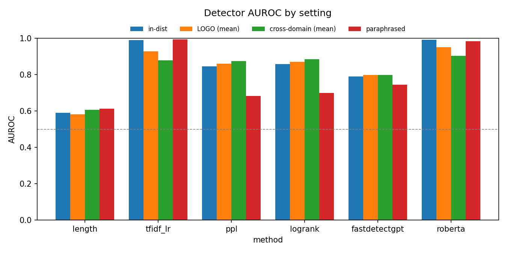

# Detecting AI-Generated Text Across Domains and Generators (P20)

Deep Learning course project, Team 20. We detect whether a text is human-written or machine-generated, and test
whether detectors still work on **unseen generators**, **unseen domains**, and **paraphrased** AI text, using the
[M4](https://github.com/mbzuai-nlp/M4) benchmark (English).

**Detectors:** TF-IDF + logistic regression (baseline) → fine-tuned RoBERTa → zero-shot perplexity / log-rank / Fast-DetectGPT (the one-pass form of DetectGPT).
**Settings:** in-distribution, leave-one-generator-out, leave-one-domain-out, paraphrase attack.

## Team

| Role | Member | GitHub |
|---|---|---|
| A: Data & Baseline (lead) | Nirmal Kumar | [@NIRMAL20062](https://github.com/NIRMAL20062) |
| B: RoBERTa | Vivek Kumar | [@VIVEK342004](https://github.com/VIVEK342004) |
| C: Zero-shot | Ritesh Jha | [@RITESHJHA2244](https://github.com/RITESHJHA2244) |
| D: Attack & Results | Vishal Kumar | [@kumar-vishal01](https://github.com/kumar-vishal01) |

## Docs
 
- [docs/PROJECT_BRIEF.md](docs/PROJECT_BRIEF.md): the instructor's original assignment, word for word, mapped to the repo
- [AGENTS.md](AGENTS.md): start here if you are an AI coding agent (or new to the repo)
- [docs/ROADMAP.md](docs/ROADMAP.md): what we're building, the evaluation settings, timeline, risks
- [docs/TASKS.md](docs/TASKS.md): who codes what, and the shared data/split/prediction formats (read §0 first)
- [CONTRIBUTING.md](CONTRIBUTING.md): how we work day to day (branches, PRs, Kaggle runs, getting results back)
- [report/report.tex](report/report.tex): the project report (course NLE LaTeX template; figures in `report/figures/`)
- [docs/viva_A.md](docs/viva_A.md): viva notes for the data, evaluation and baseline part

## Setup

```bash
git clone https://github.com/NIRMAL20062/generated_text_detection.git
cd generated_text_detection
uv venv --python 3.11 && source .venv/bin/activate
uv pip install -r requirements.txt   # plus torch if you run models locally
```

## Results

Test AUROC (higher is better, 0.5 = chance) on M4 English, from `results/*/*/metrics.json`. Full tables with 95% CIs,
accuracy, macro-F1 and TPR@1%FPR: [results/tables.md](results/tables.md); figures: [results/figures/](results/figures/);
report: [report/report.tex](report/report.tex).

| Detector | In-distribution | Unseen generator (mean) | Unseen domain (mean) | Paraphrase: before → after |
|---|---|---|---|---|
| Length only (shortcut check) | 0.591 | 0.582 | 0.605 | 0.589 → 0.613 |
| TF-IDF + LR | 0.990 | 0.928 | 0.877 | 0.991 → 0.994 |
| Log-likelihood (GPT-2 medium) | 0.845 | 0.860 | 0.874 | 0.846 → 0.683 |
| Log-rank | 0.857 | 0.870 | 0.885 | 0.860 → 0.699 |
| Fast-DetectGPT* | 0.789 | 0.797 | 0.798 | 0.789 → 0.743 |
| RoBERTa (fine-tuned) | 0.991 | 0.951 | 0.903 | 0.990 → 0.984 |

\*Fast-DetectGPT scores a 1,500-text subset (plus the paraphrase test sets), so its intervals are wider.

- Supervised detectors win everywhere, but RoBERTa's lead over zero-shot log-rank shrinks from 0.13 in distribution to
  0.02 on unseen domains. BLOOMZ is the hardest held-out generator for every detector.
- Paraphrasing lowers the likelihood-based scores by ~0.16 AUROC but not the supervised ones, which instead flag
  paraphrased *human* text as machine (`paraphrase_human` control).
- Caveats: a length shortcut exists for held-out BLOOMZ, Reddit and wikiHow, and M4 human texts contain formatting
  remnants (`references`, `_url_0_`) that TF-IDF uses (`results/tfidf_lr/indist/top_features.csv`).



## How to reproduce

Every script has `--dev`, which runs on the committed `data/sample_dev.parquet` in under 2 minutes on CPU and
writes to `results_dev/`. Full runs need the data (step 1) and, for the model steps, a GPU (we used Kaggle T4).
On Kaggle, attach the `team20-m4-processed` dataset and run `notebooks/kaggle_all.ipynb`, which does steps 3–6.

```bash
# 1. Data: download M4, build data/processed/m4_en.parquet, splits/*.json and results/data_audit.md
python -m src.data --all
python -m src.data --check-splits          # every split id exists, no group crosses train/val/test

# 2. Baselines (CPU, ~1-2 h for all settings)
python -m src.baseline_tfidf --method length
python -m src.baseline_tfidf --method tfidf_lr

# 3. Paraphrase attack (GPU): outputs/paraphrase/paraphrased.parquet + splits/paraphrase*.json
python -m src.paraphrase

# 4. Zero-shot detectors (GPU)
python -m src.zeroshot --method ppl
python -m src.zeroshot --method logrank
python -m src.zeroshot --method fastdetectgpt

# 5. RoBERTa (GPU): indist first, its model is reused for the paraphrase settings
python -m src.train_roberta --setting indist
python -m src.train_roberta --setting paraphrase --predict-only --model outputs/roberta/indist/model
python -m src.train_roberta --setting logo_chatGPT --no-save     # ... every logo_* and xdomain_*

# 6. Metrics for every run, then the report tables and figures
for f in results/*/*/preds.csv; do python -m src.eval "$f"; done
python -m src.make_tables                  # results/tables.md + results/figures/

# tests
python -m pytest tests/ -q
```

## References

1. E. Mitchell et al., *DetectGPT: Zero-Shot Machine-Generated Text Detection using Probability Curvature*, ICML 2023. https://arxiv.org/abs/2301.11305
2. Y. Wang et al., *M4: Multi-generator, Multi-domain, and Multi-lingual Black-Box Machine-Generated Text Detection*, EACL 2024. https://arxiv.org/abs/2305.14902
